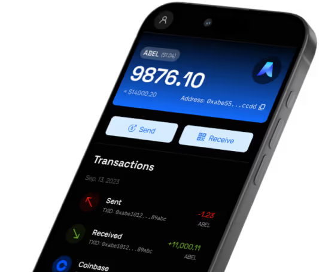

Find current Abelian application packages for mobile and desktop wallets, nodes, and mining clients. Review each product version, platform downloads, release notes, and relevant guides before installing.

## Abelian (Mobile)
🔥 We are pleased to announce that the new mobile wallet, Abelian Pro, is now available for download.

  

    
Abelian Pro Mobile App

    
Download our latest mobile wallet

  

  
  

    <a className="mobile-download-apk" href="https://download.pqabelian.io/release/android/abelian-mobile-wallet-pro-v9.1.2.apk">APK</a>
    
    
  

<Info>
The new mobile wallet is a complete rewrite of the previous mobile wallet and is designed to be more user-friendly and feature-rich.
It is available on both iOS and Android platforms.

**v9.1.2 Upgrade Notes:**
- Two-factor authentication (2FA): SupportsPasskeys and Google Authenticator.UTXO auto-consolidation and splitting.
- Improvements & Fixes:the page UI and experience.
- Fixed bugs across multiple modules and optimized.

**New version Features:**
1. Support Abelian Layer 2 network - QDay, allowing users to view blockchain data, manage ERC20 tokens, use decentralized exchanges, stake ABEL tokens across chains, and access various DeFi apps.
2. Supports both Legacy wallet addresses and new MLP addresses. For the advantages of MLP (Multi-Layer Privacy) accounts, refer to the [Desktop Wallet Pro release notes](/en/downloads/latest#desktop-wallet-pro-mlp).
3. It is recommended to create a new wallet account (MLP address) after upgrading, and transfer all ABEL balances from old accounts to the new MLP wallet account.
4. After creating the new wallet account (MLP address), Backup the 24-word mnemonic (recovery phrase) in Account "Profile." This mnemonic can be imported using the Desktop Wallet Pro.
</Info>

---

## Desktop Wallet Pro (MLP)
- **Release Date**: `2026-08-10`
- **Package Name**: `abelian-desktop-wallet-pro-v3.0.1`
- **Package Size**: `≈ 120MB`
- **Download Links**:

  [macOS (Apple Silicon)](https://github.com/pqabelian/abelian-desktop-wallet-pro/releases/download/v3.0.1/abelian-desktop-wallet-pro-macos-arm64-v3.0.1.dmg)
  [macOS (Intel)](https://github.com/pqabelian/abelian-desktop-wallet-pro/releases/download/v3.0.1/abelian-desktop-wallet-pro-macos-amd64-v3.0.1.dmg)
  [Windows](https://github.com/pqabelian/abelian-desktop-wallet-pro/releases/download/v3.0.1/abelian-desktop-wallet-pro-windows-amd64-v3.0.1.exe)
  [Linux](https://github.com/pqabelian/abelian-desktop-wallet-pro/releases/download/v3.0.1/abelian-desktop-wallet-pro-linux-amd64-v3.0.1.deb)
  [Linux (ARM)](https://github.com/pqabelian/abelian-desktop-wallet-pro/releases/download/v3.0.1/abelian-desktop-wallet-pro-linux-arm64-v3.0.1.deb)

<Info>
**What's New?**
- Faster transaction confirmations: Outputs are marked as spendable once available.
- Optimized display of spendable amounts: The input field on the send page accurately shows available amounts to maximize subsequent transfers, with a new "MAX" button that automatically calculates and deducts transaction fees for a single recipient.
- More user-friendly experience: Added additional informative tips.

**Why Should You Upgrade?**
- Existing users of Desktop Wallet Legacy are strongly recommended to migrate now to this brand new Desktop Wallet Pro (MLP) so that they no longer need to remember the maximum recoverable number of wallets. To migrate, we need to create a new wallet at the Desktop Wallet Pro (MLP) and then use the Desktop Wallet Legacy to transfer all the ABEL coins to the new wallet.
- For the first time, you can create wallets, some of them are fully-private and some others are pseudo-private.

**v3.0.0 Upgrade Notes:**
1. introduce automatic update mechanism.
2. introduce U9 batch sending for no more than 500 recipients.
3. uinified privacy type name: Shield,  Transparent, Transparent/AUT.
4. fix issues: reentrancy consolidation, unstable transaction history UI, etc.
5. improve account lifecycle management.
6. for batch-sending, using 4 columns in CSV, No., name, address, amount.
</Info>

---

## Desktop Wallet (Legacy)
- **Release Date**: `2026-01-12`
- **Package Name**: `abelian-desktop-wallet-legacy-v5.0.0`
- **Package Size**: `≈ 120MB`
- **Download Links**:

  [macOS (Apple Silicon)](https://download.pqabelian.io/release/abelwallet-desktop/abelian-desktop-wallet-legacy-macos-arm64-v5.0.0.dmg)
  [macOS (Intel)](https://download.pqabelian.io/release/abelwallet-desktop/abelian-desktop-wallet-legacy-macos-amd64-v5.0.0.dmg)
  [Windows](https://download.pqabelian.io/release/abelwallet-desktop/abelian-desktop-wallet-legacy-windows-amd64-v5.0.0.exe)
  [Linux](https://download.pqabelian.io/release/abelwallet-desktop/abelian-desktop-wallet-legacy-linux-amd64-v5.0.0.deb)
  [Linux (ARM)](https://download.pqabelian.io/release/abelwallet-desktop/abelian-desktop-wallet-legacy-linux-arm64-v5.0.0.deb)

<Warning>
- After upgrading the Desktop Wallet (Legacy) from version 4.1.1 or earlier to the latest version, you need to re-import your wallet accounts. Please refer to the [Desktop Wallet (Legacy) guide](/en/wallet/desktop/desktop-wallet-legacy) for detailed operating steps.
- Accounts on the Desktop Wallet (Legacy) cannot be imported into the mobile wallet app `Abelian` (MLP addresses), but transfers are allowed.
</Warning>

<Info>
**What's New?**
- One-Click Migration: We strongly recommend migrating from legacy wallets to MLP wallets. An MLP wallet no longer needs users to remember the maximum recoverable number of wallets. This enhances the usability greatly. Furthermore, we will only supports the brand-new MLP wallets and fades out the legacy wallet type.
- You need to install the Desktop Wallet Pro (MLP) version 2.0.0 or above, and create a new wallet account (shielded type or transparent type). Then, use the Migration Function of the Desktop Wallet (Legacy) to transfer all the ABEL tokens to the new MLP wallet account.

**Why Should You Upgrade?**
- The MLP wallet address is significantly easier to use without remembering any sequence number (aka maximum recoverable number of wallets). Furthermore, for the first time, you can choose to create multiple MLP addresses, each with different privacy level, fully-private or pseudo-private.

**v5.0.0 Upgrade Notes:**
- Support the Aconcagua Fork upgrade.
</Info>

---

## Abelian Node (abec)
- **Release Date**: `2026-09-28`
- **Package Name**: `abec-v3.3.0`
- **Package Size**: `≈ 23MB`
- **Download Links**:

  [macOS (Apple Silicon)](https://download.pqabelian.io/release/abec/abec-macos-arm64-v3.3.0.tar.gz)
  [macOS (Intel)](https://download.pqabelian.io/release/abec/abec-macos-amd64-v3.3.0.tar.gz)
  [Windows](https://download.pqabelian.io/release/abec/abec-windows-amd64-v3.3.0.zip)
  [Linux](https://download.pqabelian.io/release/abec/abec-linux-amd64-v3.3.0.tar.gz)
  [Linux (ARM)](https://download.pqabelian.io/release/abec/abec-linux-arm64-v3.3.0.tar.gz)

<Info>
- Add request-response mechanism for data synchronization.
- Add authentication and TLS for getwork protocol.
- Use parallel transaction requests instead of batched transactions requests to reduce response body size.
- Update underlying dependencies.
- Storage space requirements for running nodes in different modes: Normal Node ≈ 190GB, SemiFull Node ≈ 450GB, Full Node ≈ 1.4TB.

**For more details, Please view the link below:**
- https://www.pqabelian.io/blog/abelian-network-hard-fork-introducing-multi-level-privacy-and-user-token-protocol-at-block-height-300-000
- https://community.pqabelian.io/guide/
- https://community.pqabelian.io/guide/abelian-node
</Info>

---

## ABEL-ETHash GPU Mining Client
- **Release Date**: `2023-05-31`
- **Package Name**: `abelminer-v2.0.4`
- **Package Size**: `≈ 36MB`
- **Download Links**:

  [Windows](https://download.pqabelian.io/release/pool/abelminer-windows-amd64-v2.0.4.zip)
  [Linux](https://download.pqabelian.io/release/pool/abelminer-linux-amd64-v2.0.4.tar.gz)

<Info>
1. The ABEL-ETHash graphics card mining client can be used for solo mining and pool mining.
2. Mining Pool Website: https://maxpool.org/
3. Please visit the mining pool website for the [Quick Start Guide](https://maxpool.org/home/guide) and select the suitable hardware and system platform to set up mining.
4. Please join our [Discord community](https://discord.com/invite/5rrDxP29hx) and go to the mining channel (under 'how-to-mine-abel' after 'verify-yourself') to get the latest guide for ABEL-ETHash GPU solo mining.
</Info>

---

## ABEL-ETHash CPU Mining Client
- **Release Date**: `2023-07-18`
- **Package Name**: `abelminer-cpu-v0.13.2`
- **Package Size**: `≈ 5.5MB`
- **Download Links**:

  [macOS (Apple Silicon)](https://download.pqabelian.io/release/pool/abelminer-cpu-macos-arm64-v0.13.2.tar.gz)
  [macOS (Intel)](https://download.pqabelian.io/release/pool/abelminer-cpu-macos-amd64-v0.13.2.tar.gz)
  [Windows](https://download.pqabelian.io/release/pool/abelminer-cpu-windows-amd64-v0.13.2.zip)
  [Linux](https://download.pqabelian.io/release/pool/abelminer-cpu-linux-amd64-v0.13.2.tar.gz)
  [Linux (ARM)](https://download.pqabelian.io/release/pool/abelminer-cpu-linux-arm64-v0.13.2.tar.gz)

<Info>
1. This ABEL-ETHash CPU mining client can be used by everyone who has a PC/laptop for ABEL mining.
2. This is optimized for pool mining. Mining Pool Website: [Maxpool](https://maxpool.org).
3. Mining Pool Website: https://maxpool.org. Please visit [Account/Settings](https://maxpool.org/account/settings) to read the CPU mining guide.
4. If you have GPU cards, please check out the section above titled ["Abelian GPU Mining Client"](#abel-ethash-gpu-mining-client) for GPU pool mining. If you want to do GPU solo mining, please join our [Discord community](https://discord.com/invite/5rrDxP29hx) and go to the mining channel (under 'how-to-mine-abel' after 'verify-yourself') to get the latest guide.
</Info>

---

## ABEL-Nakamoto CPU Mining Client
- **Release Date**: `2026-01-11`
- **Package Name**: `abel-nakamoto-cpu-miner-v0.1.0`
- **Package Size**: `≈ 1.3MB`
- **Download Links**:

  [macOS (Apple Silicon)](https://download.pqabelian.io/release/abel-nakamoto/abel-nakamoto-cpu-miner-macos-arm64-v0.1.0.tar.gz)
  [macOS (Intel)](https://download.pqabelian.io/release/abel-nakamoto/abel-nakamoto-cpu-miner-macos-amd64-v0.1.0.tar.gz)
  [Windows](https://download.pqabelian.io/release/abel-nakamoto/abel-nakamoto-cpu-miner-windows-amd64-v0.1.0.zip)
  [Linux](https://download.pqabelian.io/release/abel-nakamoto/abel-nakamoto-cpu-miner-linux-amd64-v0.1.0.tar.gz)
  [Linux (ARM)](https://download.pqabelian.io/release/abel-nakamoto/abel-nakamoto-cpu-miner-linux-arm64-v0.1.0.tar.gz)

<Info>
1. This ABEL-Nakamoto CPU mining client can be used by anyone with a PC/laptop for ABEL mining.
2. ABEL-Nakamoto Mining Pool Website: [abel-nakamoto.xyz](https://abel-nakamoto.xyz).
3. Please visit the mining pool website [Account/Settings](https://abel-nakamoto.xyz/account/settings) to get your mining command.
4. Please read the [ABEL-Nakamoto mining FAQ](/en/faq/community/pow-mining) and follow the steps that apply to your hardware and system platform.
</Info>

---

## CLI Wallet (MLP)
- **Release Date**: `2026-09-28`
- **Package Name**: `abewalletmlp-v3.1.0`
- **Package Size**: `≈ 24MB`
- **Download Links**:

  [macOS (Apple Silicon)](https://download.pqabelian.io/release/abewalletmlp/abewalletmlp-macos-arm64-v3.1.0.tar.gz)
  [macOS (Intel)](https://download.pqabelian.io/release/abewalletmlp/abewalletmlp-macos-amd64-v3.1.0.tar.gz)
  [Windows](https://download.pqabelian.io/release/abewalletmlp/abewalletmlp-windows-amd64-v3.1.0.zip)
  [Linux](https://download.pqabelian.io/release/abewalletmlp/abewalletmlp-linux-amd64-v3.1.0.tar.gz)
  [Linux (ARM)](https://download.pqabelian.io/release/abewalletmlp/abewalletmlp-linux-arm64-v3.1.0.tar.gz)

<Info>
**What's New?**
- Disable to log seed and secret information.

**Why should you upgrade?**
- Full compatibility: Users can continue to use the Abelian CLI Wallet (MLP) v1.0.1, but all subsequent Abelian CLI Wallets will be based on the version of Abelian CLI Wallet (MLP) v3.0.0;
- Facilitate the import/export of mnemonic phrases across Desktop Wallet Pro v1.0.0 and Abelian CLI Wallet (MLP) v3.0.0;
- Support Abelian node Aconcagua fork (height 464,000).

**For more details, Please view the link below:**
- https://www.pqabelian.io/blog/abelian-multi-layer-privacy-wallet-cli-user-guide
</Info>

---

## CLI Wallet Legacy
- **Release Date**: `2026-01-02`
- **Package Name**: `abewalletlegacy-v3.0.0`
- **Package Size**: `≈ 24MB`
- **Download Links**:

  [macOS (Apple Silicon)](https://download.pqabelian.io/release/abewallet/abewalletlegacy-macos-arm64-v3.0.0.tar.gz)
  [macOS (Intel)](https://download.pqabelian.io/release/abewallet/abewalletlegacy-macos-amd64-v3.0.0.tar.gz)
  [Windows](https://download.pqabelian.io/release/abewallet/abewalletlegacy-windows-amd64-v3.0.0.zip)
  [Linux](https://download.pqabelian.io/release/abewallet/abewalletlegacy-linux-amd64-v3.0.0.tar.gz)
  [Linux (ARM)](https://download.pqabelian.io/release/abewallet/abewalletlegacy-linux-arm64-v3.0.0.tar.gz)

<Info>
1. Rename abewallet to abewalletlegacy, which only supports the old address format.
2. We recommend all existing abewallet users to re-import all of their accounts after installed the new abewalletlegacy.
</Info>

## Abelian Applications Release History

For previous versions, see [Abelian Applications Release History](/en/downloads/release-history).

## Abelian Manuals

More documentation for users and developers is available in the Abelian documentation.

- [Applications basics](/en/learn/applications-basics)
- [Desktop wallet](/en/wallet/desktop/desktop-wallet-pro)
- [CLI wallet](/en/wallet/cli/cli-wallet-mlp)
- [Mining guide](/en/operate/miners)
- [Node guide](/en/operate/nodes)
