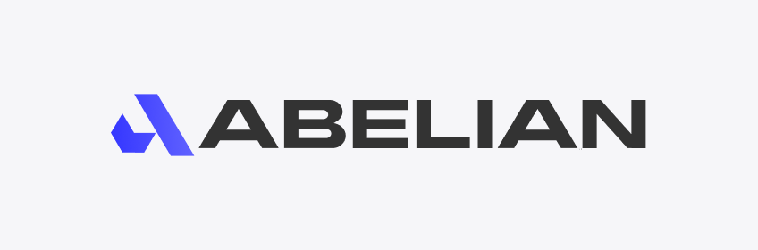

# Operate the Abelian network

Run an Abelian node to connect to and support the network, or choose a mining guide for your hardware and preferred proof-of-work algorithm.

## Browse operation guides

<Columns cols={2}>
	<Card title="Run an Abelian node" icon="server" href="/en/operate/nodes/abelian-node">
		Install and configure `abec`, select a node type, and synchronize with the network.
	</Card>
	<Card title="ABEL-ETHash CPU mining" icon="microchip" href="/en/operate/miners/cpu-mining">
		Configure solo or pool-based CPU mining with the ABEL-ETHash algorithm.
	</Card>
	<Card title="ABEL-ETHash GPU mining" icon="computer" href="/en/operate/miners/gpu-mining">
		Set up solo or pool-based GPU mining and configure your mining client.
	</Card>
	<Card title="ABEL-Nakamoto CPU mining" icon="microchip" href="/en/operate/miners/nakamoto-cpu-miner">
		Connect the ABEL-Nakamoto CPU miner to a pool and configure its workers.
	</Card>
	<Card title="Hako Metal ASIC miner" icon="bolt" href="/en/operate/miners/hako-metal">
		Review the Hakometal20 overview, manufacturer specifications, and setup notes.
	</Card>
</Columns>