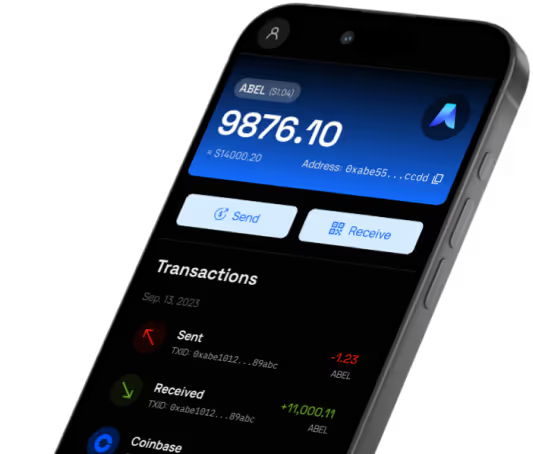

在安裝前，請確認產品版本與作業系統，並閱讀相應的發布說明和使用指南。
## Abelian (移動應用)
🔥 我們很高興宣布：新的移動錢包 Abelian Pro 現已可供下載。

  

    
Abelian Pro 行動應用程式

    
下載最新版行動錢包

  

  
  

    <a className="mobile-download-apk" href="https://download.pqabelian.io/release/android/abelian-mobile-wallet-pro-v9.1.2.apk">APK</a>
    
    
  

<Info>
新的移動錢包是對之前移動錢包的全面重寫，旨在更加用戶友好和功能豐富。它可在 iOS 和 Android 平台上使用。

**v9.1.2 升級說明:**
- 雙重認證（2FA）：支援通行密鑰（Passkeys）與 Google Authenticator。
- 支援 UTXO 自動合併與拆分。
- 改進與修復：優化頁面 UI 與使用體驗，並修復多個模組中的錯誤。

**新版本特性：**
1. 支持 Abelian 二級網路 - QDay，允許用戶瀏覽區塊鏈數據、管理 ERC20 代幣、使用去中心化交易所、跨鏈質押 ABEL 代幣，以及訪問各種 DeFi 應用。
2. 同時支援 Legacy 和新的 MLP 錢包地址。關於 MLP（多層隱私）帳戶的優勢，請參閱[桌面錢包專業版發布說明](/zh/downloads/latest#桌面錢包專業版-mlp)。
3. 推薦升級到新版後創建新的錢包賬戶（MLP 地址），並在創建新的 MLP 錢包賬戶後，將所有舊賬戶的餘額 ABEL 幣從轉賬至 MLP 錢包賬戶；
4. 創建新的錢包賬戶（MLP 地址）後，在「賬戶資料」中備份 24 個單詞的助記詞（恢復短語），可以使用桌面錢包專業版導入此助記詞。
</Info>

---

## 桌面錢包專業版 (MLP)
- **發布日期**: `2026-08-10`
- **軟體名稱**: `abelian-desktop-wallet-pro-v3.0.1`
- **軟體大小**: `≈ 120MB`
- **下載連結**:

  [macOS (Apple Silicon)](https://github.com/pqabelian/abelian-desktop-wallet-pro/releases/download/v3.0.1/abelian-desktop-wallet-pro-macos-arm64-v3.0.1.dmg)
  [macOS (Intel)](https://github.com/pqabelian/abelian-desktop-wallet-pro/releases/download/v3.0.1/abelian-desktop-wallet-pro-macos-amd64-v3.0.1.dmg)
  [Windows](https://github.com/pqabelian/abelian-desktop-wallet-pro/releases/download/v3.0.1/abelian-desktop-wallet-pro-windows-amd64-v3.0.1.exe)
  [Linux](https://github.com/pqabelian/abelian-desktop-wallet-pro/releases/download/v3.0.1/abelian-desktop-wallet-pro-linux-amd64-v3.0.1.deb)
  [Linux (ARM)](https://github.com/pqabelian/abelian-desktop-wallet-pro/releases/download/v3.0.1/abelian-desktop-wallet-pro-linux-arm64-v3.0.1.deb)

<Info>
**有什麼新功能？**
- 交易確認更快，一旦交易輸出可用，就會被標記為可支配。
- 優化可支配金額顯示，在發送頁面，輸入框會精確顯示可用金額，以便最大化後續轉賬，並新增"最大"按鈕，在轉賬給一個收款人時可以自動計算並扣除交易費用。
- 使用體驗更友好直觀，增加了更多提示資訊。

**為什麼要升級？**
- 強烈建議現有桌面錢包經典版（Legacy）用戶立即遷移到這個全新的桌面錢包專業版（MLP），這樣他們不再需要記住最大可恢復的錢包數量。要進行遷移，我們需要在桌面錢包專業版（MLP）中創建一個新錢包，然後使用桌面錢包經典版將所有 ABEL 幣轉移到新錢包中。
- 您可以首次創建一些完全私密的錢包以及其他匿名私密的錢包。

**v3.0.1 升級說明:**
- 自動更新機制；
- U9 批量發送（最多 500 個收款人）；
- 統一隱私類型名稱：Shield、Transparent、Transparent/AUT；
- 修復問題：重入合併、不穩定的交易歷史 UI 等；
- 改善賬戶生命週期管理；
- 批量發送 CSV 文件使用4列格式：No., name, address, amount。
</Info>

---

## 桌面錢包經典版
- **發布日期**： `2026-01-12`
- **軟體名稱**： `abelian-desktop-wallet-legacy-v5.0.0`
- **軟體大小**： `≈ 120MB`
- **下載連結**：

  [macOS (Apple Silicon)](https://download.pqabelian.io/release/abelwallet-desktop/abelian-desktop-wallet-legacy-macos-arm64-v5.0.0.dmg)
  [macOS (Intel)](https://download.pqabelian.io/release/abelwallet-desktop/abelian-desktop-wallet-legacy-macos-amd64-v5.0.0.dmg)
  [Windows](https://download.pqabelian.io/release/abelwallet-desktop/abelian-desktop-wallet-legacy-windows-amd64-v5.0.0.exe)
  [Linux](https://download.pqabelian.io/release/abelwallet-desktop/abelian-desktop-wallet-legacy-linux-amd64-v5.0.0.deb)
  [Linux (ARM)](https://download.pqabelian.io/release/abelwallet-desktop/abelian-desktop-wallet-legacy-linux-arm64-v5.0.0.deb)

<Warning>
- 將 Desktop Wallet（Legacy）從 4.1.1 或更早版本升級至最新版本後，您需要重新匯入錢包帳戶。詳細操作步驟請參考［Desktop Wallet（Legacy）使用手冊］(/zh/guide/wallet/desktop-wallet-legacy#導入-abel-錢包帳戶)。
- Desktop Wallet（Legacy）上的帳戶無法匯入至行動錢包應用程式 `Abelian`（MLP 位址），但可以進行轉帳。
</Warning>

<Info>
**有什麼新功能？**
- 一鍵遷移：我們強烈建議從舊版錢包遷移到 MLP 錢包。MLP 錢包不再需要用戶記住最大可恢復的錢包數量，這大大提高了可用性。此外，我們將僅支援全新的 MLP 錢包，並逐步淘汰舊版錢包類型。
- 您需要安裝桌面錢包專業版（MLP）2.0.0 以上版本，並建立新的錢包帳戶（偽隱私或透明類型）。接著，使用桌面錢包（經典版）的遷移功能，將所有 ABEL 代幣轉移至新的 MLP 錢包帳戶。

**為什麼要升級？**
- MLP 錢包地址在無需記住任何序列號（即最大可恢復的錢包數量）的情況下顯著更易於使用。此外，您可以首次選擇創建多個具有不同隱私級別的 MLP 地址，包括完全私密或偽私密。

**v5.0.0 升級說明:**
- 支援「aconcagua」分叉。
</Info>

---

## Abelian 節點（abec）
- **發布日期**： `2026-09-28`
- **軟體名稱**： `abec-v3.3.0`
- **軟體大小**： `≈ 23MB`
- **下載連結**：

  [macOS (Apple Silicon)](https://download.pqabelian.io/release/abec/abec-macos-arm64-v3.3.0.tar.gz)
  [macOS (Intel)](https://download.pqabelian.io/release/abec/abec-macos-amd64-v3.3.0.tar.gz)
  [Windows](https://download.pqabelian.io/release/abec/abec-windows-amd64-v3.3.0.zip)
  [Linux](https://download.pqabelian.io/release/abec/abec-linux-amd64-v3.3.0.tar.gz)
  [Linux (ARM)](https://download.pqabelian.io/release/abec/abec-linux-arm64-v3.3.0.tar.gz)

<Info>
- 新增交易同步的請求-響應機制。
- 為 getwork 協議新增認證和 TLS.
- 使用並行交易請求而不是批量交易請求以減少響應主體大小.
- 更新底層依賴.
- 運行不同模式節點的存儲空間需求：常規節點約 190GB，半全節點約 450GB，全節點約 1.4TB.

**了解更多詳情，請查看以下連結：**
- https://www.pqabelian.io/blog/abelian-network-hard-fork-introducing-multi-level-privacy-and-user-token-protocol-at-block-height-300-000
- https://community.pqabelian.io/guide/
- https://community.pqabelian.io/guide/abelian-node
</Info>

---

## ABEL-ETHash 顯示卡挖礦客戶端
- **發布日期**： `2023-05-31`
- **軟體名稱**： `abelminer-v2.0.4`
- **軟體大小**： `≈ 36MB`
- **下載連結**：

  [Windows](https://download.pqabelian.io/release/pool/abelminer-windows-amd64-v2.0.4.zip)
  [Linux](https://download.pqabelian.io/release/pool/abelminer-linux-amd64-v2.0.4.tar.gz)

<Info>
1. ABEL-ETHash 顯示卡挖礦客戶端可用於 Solo 挖礦和礦池挖礦；
2. 礦池網站：https://maxpool.org/
3. 請訪問礦池網站閱讀 [快速入門指南](https://maxpool.org/home/guide)，選擇適合您的硬體和系統平台按照步驟部署挖礦；
4. 請加入我們的 [Discord 社群](https://discord.com/invite/5rrDxP29hx)，並前往挖礦頻道（在 “verify-yourself” 之後前往 “how-to-mine-abel” 子頻道）獲取 ABEL-ETHash GPU Solo 挖礦的最新指南。
</Info>

---

## ABEL-ETHash CPU 挖礦客戶端
- **發布日期**： `2025-07-18`
- **軟體名稱**： `abelminer-cpu-v0.13.2`
- **軟體大小**： `≈ 5.5MB`
- **下載連結**：

  [macOS (Apple Silicon)](https://download.pqabelian.io/release/pool/abelminer-cpu-macos-arm64-v0.13.2.tar.gz)
  [macOS (Intel)](https://download.pqabelian.io/release/pool/abelminer-cpu-macos-amd64-v0.13.2.tar.gz)
  [Windows](https://download.pqabelian.io/release/pool/abelminer-cpu-windows-amd64-v0.13.2.zip)
  [Linux](https://download.pqabelian.io/release/pool/abelminer-cpu-linux-amd64-v0.13.2.tar.gz)
  [Linux (ARM)](https://download.pqabelian.io/release/pool/abelminer-cpu-linux-arm64-v0.13.2.tar.gz)

<Info>
1. 此 ABEL-ETHash CPU 挖礦客戶端可以被所有擁有 PC/筆記型電腦的人用於 ABEL 挖礦；
2. 該客戶端針對礦池挖礦進行了優化，礦池網站：https://maxpool.org/
3. 礦池網站：https://maxpool.org/，請訪問 [帳戶設定](https://maxpool.org/account/settings) 閱讀 CPU 挖礦指南。
4. 如果你有 GPU 顯示卡，請查看上面標題為 [“Abelian GPU 挖礦客戶端”](#abel-ethash-顯示卡挖礦客戶端) 的部分以獲取 GPU 礦池挖礦資訊。如果你想進行 GPU 單獨挖礦，請加入我們的 [Discord 社群](https://discord.com/invite/5rrDxP29hx)，並進入挖礦頻道（在“verify-yourself”後面的“how-to-mine-abel”下）獲取最新指南。
</Info>

---

## ABEL-Nakamoto CPU 挖礦客戶端
- **Release Date**: `2026-01-11`
- **Package Name**: `abel-nakamoto-cpu-miner-v0.1.0`
- **Package Size**: `≈ 1.3MB`
- **Download Links**:

  [macOS (Apple Silicon)](https://download.pqabelian.io/release/abel-nakamoto/abel-nakamoto-cpu-miner-macos-arm64-v0.1.0.tar.gz)
  [macOS (Intel)](https://download.pqabelian.io/release/abel-nakamoto/abel-nakamoto-cpu-miner-macos-amd64-v0.1.0.tar.gz)
  [Windows](https://download.pqabelian.io/release/abel-nakamoto/abel-nakamoto-cpu-miner-windows-amd64-v0.1.0.zip)
  [Linux](https://download.pqabelian.io/release/abel-nakamoto/abel-nakamoto-cpu-miner-linux-amd64-v0.1.0.tar.gz)
  [Linux (ARM)](https://download.pqabelian.io/release/abel-nakamoto/abel-nakamoto-cpu-miner-linux-arm64-v0.1.0.tar.gz)

<Info>
1. 此 ABEL-Nakamoto CPU 挖礦客戶端可以被所有擁有 PC/筆記型電腦的人用於 ABEL 挖礦；
2. ABEL-Nakamoto 礦池網站：[abel-nakamoto.xyz](https://abel-nakamoto.xyz)；
3. 請訪問礦池網站 [帳戶/設定](https://abel-nakamoto.xyz/account/settings) 取得您的挖礦命令；
4. 請閱讀 [ABEL-Nakamoto 挖礦常見問題](/zh/faq/community/pow-mining)，並依照適合您硬體和作業系統的步驟部署挖礦。
</Info>

---

## 多層隱私錢包 (CLI)
- **發布日期**： `2026-09-28`
- **軟體名稱**： `abewalletmlp-v3.1.0`
- **軟體大小**： `≈ 24MB`
- **下載連結**：

  [macOS (Apple Silicon)](https://download.pqabelian.io/release/abewalletmlp/abewalletmlp-macos-arm64-v3.1.0.tar.gz)
  [macOS (Intel)](https://download.pqabelian.io/release/abewalletmlp/abewalletmlp-macos-amd64-v3.1.0.tar.gz)
  [Windows](https://download.pqabelian.io/release/abewalletmlp/abewalletmlp-windows-amd64-v3.1.0.zip)
  [Linux](https://download.pqabelian.io/release/abewalletmlp/abewalletmlp-linux-amd64-v3.1.0.tar.gz)
  [Linux (ARM)](https://download.pqabelian.io/release/abewalletmlp/abewalletmlp-linux-arm64-v3.1.0.tar.gz)

<Info>
**有什麼新功能？**
- 禁止記錄種子和私密資訊。

**為什麼要升級？**
- 完全相容性：用戶可以繼續使用 Abelian 多層隱私錢包 (CLI) v1.0.1，但所有後續的 Abelian 經典錢包 (CLI) 都將基於 Abelian 多層隱私錢包 (CLI) v3.0.0 的版本；
- 方便在桌面錢包專業版 v1.0.0 和 Abelian 多層隱私錢包 (CLI) v3.0.0 之間導入/導出助記詞；
- 支援 Abelian 節點「Aconcagua」分叉（高度 464,000）。

**更多詳情，請查看以下連結：**
- https://www.pqabelian.io/blog/abelian-multi-layer-privacy-wallet-cli-user-guide
</Info>

---

## 經典錢包 (CLI)
- **發布日期**： `2026-01-02`
- **軟體名稱**： `abewalletlegacy-v3.0.0`
- **軟體大小**： `≈ 24MB`
- **下載連結**：

  [macOS (Apple Silicon)](https://download.pqabelian.io/release/abewallet/abewalletlegacy-macos-arm64-v3.0.0.tar.gz)
  [macOS (Intel)](https://download.pqabelian.io/release/abewallet/abewalletlegacy-macos-amd64-v3.0.0.tar.gz)
  [Windows](https://download.pqabelian.io/release/abewallet/abewalletlegacy-windows-amd64-v3.0.0.zip)
  [Linux](https://download.pqabelian.io/release/abewallet/abewalletlegacy-linux-amd64-v3.0.0.tar.gz)
  [Linux (ARM)](https://download.pqabelian.io/release/abewallet/abewalletlegacy-linux-arm64-v3.0.0.tar.gz)

<Info>
1. 將 `abewallet` 重新命名為 `abewalletlegacy`，僅支援舊地址格式。
2. 我們建議所有現有的 `abewallet` 用戶在安裝新的 `abewalletlegacy` 後重新導入他們的所有帳戶。
</Info>

## Abelian 應用程式歷史版本

查看更多歷史版本下載地址, 請訪問 [Abelian 應用程式歷史版本](/zh/downloads/release-history) 頁面。

## Abelian 用戶手冊

更多使用者與開發者文件，請瀏覽 Abelian 文件網站。

- [應用程式基礎](/zh/learn/applications-basics)
- [桌面錢包](/zh/wallet/desktop-wallet)
- [命令列錢包](/zh/wallet/cli-wallet)
- [挖礦指南](/zh/operate/miners)
- [節點指南](/zh/operate/nodes)
