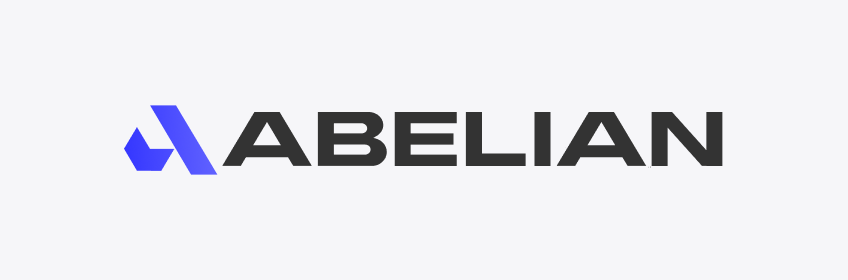

Abelian 是一條混合工作量證明（PoW）的 Layer 1 區塊鏈，自 2022 年推出以來即採用後量子格密碼學。你可以透過本文件開始使用 Abelian、了解錢包與節點、建立整合應用，並尋找支援資訊。

<Columns cols={3}>
	<Card title="開始使用" icon="book-open" href="/zh/learn/applications-basics">
		先了解 Abelian 應用程式，再選擇桌面、行動或命令列錢包指南。
	</Card>
	<Card title="使用 Abelian 開發" icon="code" href="/zh/build/core-api">
		探索核心與錢包 API、Abelian 名稱服務，以及 Java SDK。
	</Card>
	<Card title="營運網路" icon="server" href="/zh/operate/nodes">
		查閱節點與礦工指南、教學、下載資源和疑難排解資訊。
	</Card>
</Columns>

## 你可以在這裡

### 開始學習並使用錢包

- 從 [Abelian 應用程式基礎](/zh/learn/applications-basics) 開始。
- 選擇[桌面錢包](/zh/wallet/desktop-wallet)、[行動錢包](/zh/wallet/mobile-wallet)或[命令列錢包](/zh/wallet/cli-wallet)指南。

### 建立整合應用

- 使用[核心 API](/zh/build/core-api)呼叫 abec JSON-RPC 方法。
- 查閱[錢包 API](/zh/build/wallet-api)與[Abelian 名稱服務 API](/zh/build/ans-api)。
- 從[Java SDK](/zh/build/java-sdk/index)及其[示範指南](/zh/build/java-sdk/demo)開始。

### 營運與疑難排解

- 閱讀[執行 Abelian 節點](/zh/operate/nodes)與[挖礦](/zh/operate/miners)的相關資訊。
- 瀏覽[教學指南](/zh/tutorials/tutorials)與[下載](/zh/downloads/downloads)資源。
- 在[常見問題](/zh/faq/index)中尋找錢包、軟體、硬體、礦池、交易所和挖礦相關解答。

## Abelian 概覽

Abelian 的混合工作量證明模型採用兩種挖礦演算法：ABEL-ETHash 與 ABEL-Nakamoto。專案文件說明這兩種演算法皆具抗量子能力，並介紹各自不同的硬體設計目標。詳情請參閱[挖礦常見問題](/zh/faq/community/pow-mining)。

Abelian 網路使用後量子格密碼學。錢包提供多種隱私選項，讓使用者可以透明、私密或具可稽核隱私地進行交易。[錢包文件](/zh/wallet/desktop-wallet)與[Abelian 名稱服務 API](/zh/build/ans-api)介紹相關錢包和地址流程。

## 取得協助並參與貢獻

使用文件搜尋依關鍵字尋找內容。如果你發現文件有誤，或想分享經驗、開源專案或工具，歡迎在 [GitHub 開立 issue](https://github.com/pqabelian/abelian-community/issues/new)。你可以選擇匿名或註明貢獻者身分。

如需社群協助，請加入 [Abelian Discord](https://discord.gg/Rrb33mC3Kc)。社群建議需要支援時，在 Ticket 頻道提交工單。
